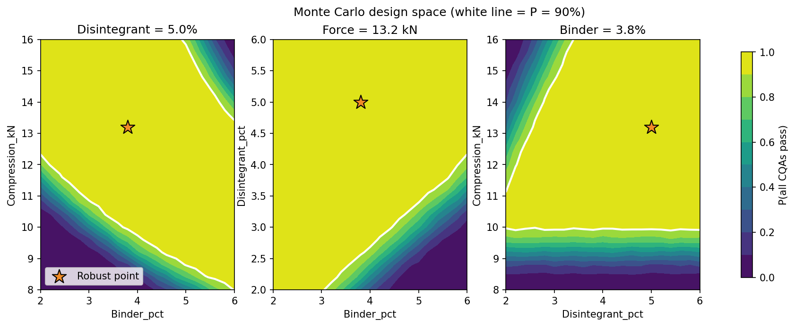
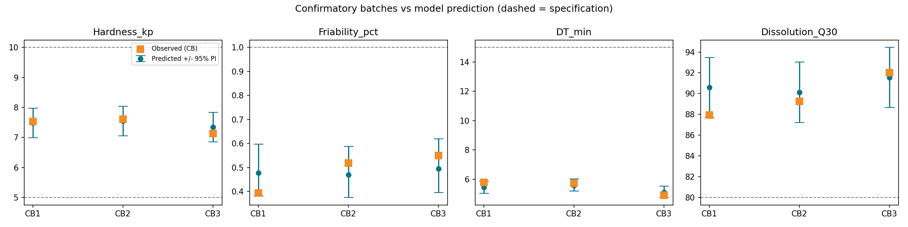
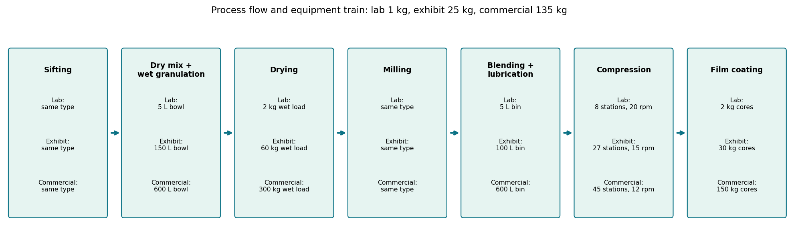

# QbD Tablet Process Development: DoE, Design Space and Scale-Up (Simulated)


An end-to-end Quality by Design (QbD) workflow for a **hypothetical** 100 mg immediate-release tablet made by wet
granulation, built in Python: risk assessment (FMEA) → Box-Behnken DoE → response-surface models → Monte Carlo
design space → confirmatory batches → scale-up plan and control strategy.

> **Important:** the experimental responses are **simulated** from documented relationships (see
> [`report/QbD_Process_Development_Report.md`](report/QbD_Process_Development_Report.md), Appendix A). This project
> demonstrates a method; it is not a real formulation or laboratory data.



## Key results

| Item | Result |
|---|---|
| Critical factors (from FMEA of 10 parameters) | Binder %, disintegrant %, compression force |
| Design | Box-Behnken, 15 runs (3 centre points), 4 responses |
| Model quality | Predicted R² 0.955 to 0.993; lack-of-fit not significant for all four |
| Validation vs known simulator effects | 16 of 18 true effects inside 95% CI; 1 false positive |
| Proposed operating point | Binder 3.8%, disintegrant 5.0% (practical limit), force 13.2 kN |
| Probability all CQAs pass (Monte Carlo) | 100% in 10,000 simulated runs (design space = 56.2% of explored cube) |
| Confirmatory batches | 12 of 12 results within specification; 12 of 12 inside 95% prediction interval |
| Batch sizes | Lab 1 kg, exhibit 25 kg, commercial 135 kg (coating pan is the limiting unit) |
| Capacity check | 112 batches/year, about 1,867 press hours/year (assumed demand 60 million tablets/year) |

## Workflow

| Step | Script | Output |
|---|---|---|
| 1. QTPP, CQAs and FMEA risk ranking | `step1_qtpp_fmea.py` | `qtpp_cqa.csv`, `fmea.csv`, `fmea_pareto.png` |
| 2. Box-Behnken design | `step2_doe_design.py` | `doe_design.csv`, `doe_design_plot.png` |
| 3. Simulated responses | `step3_simulate_responses.py` | `doe_results.csv`, `response_main_effects.png` |
| 4. Response-surface models and ANOVA | `step4_rsm_anova.py` | `model_summary.csv`, `model_coefficients.csv`, `validation_vs_truth.csv`, `models.json` |
| 5. Desirability and Monte Carlo design space | `step5_design_space.py` | `design_space_grid.csv`, `step5_results.json`, `design_space.png` |
| 6. Confirmatory batches | `step6_confirmatory_batches.py` | `cb_results.csv`, `cb_confirmation.png` |
| 7. Scale-up plan and control strategy | `step7_scaleup_plan.py` | raw materials, equipment train, scale-up parameters, control strategy, flow chart |




## How to reproduce

```
pip install -r requirements.txt
python run_all.py
```

All outputs are written to `outputs/`. The random seeds are fixed, so results are reproducible.

## Limitations

- Simulated data and assumed coefficients; the confirmation step uses the same simulator as the DoE, so it validates the
  analysis pipeline, not a real product.
- Valid only inside the studied factor ranges; granulation endpoint, drying, milling and API particle size were held fixed.
- Equipment sizes, densities and demand are generic assumptions (report Appendix B); scale-up parameters are starting
  points to be confirmed in exhibit batches.

## Repository structure

```
.
├── README.md
├── requirements.txt
├── run_all.py
├── step1_qtpp_fmea.py ... step7_scaleup_plan.py
├── report/QbD_Process_Development_Report.md
└── outputs/            # generated by the scripts
```

## Author
Harsh Paswan, B.Tech Chemical Engineering, BIT Mesra. GitHub: [@harshpaswanpro](https://github.com/harshpaswanpro)
