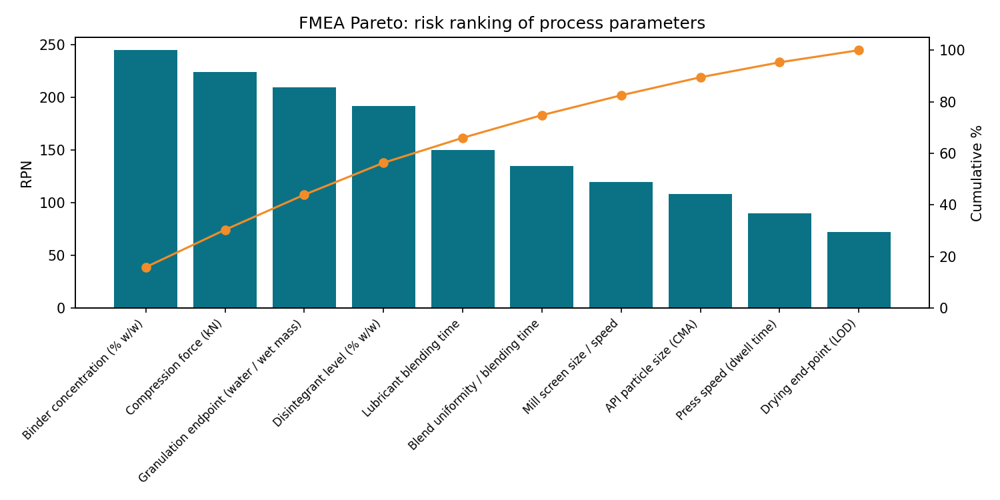
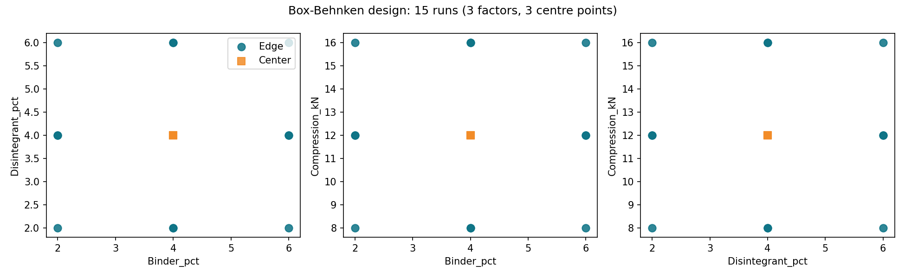
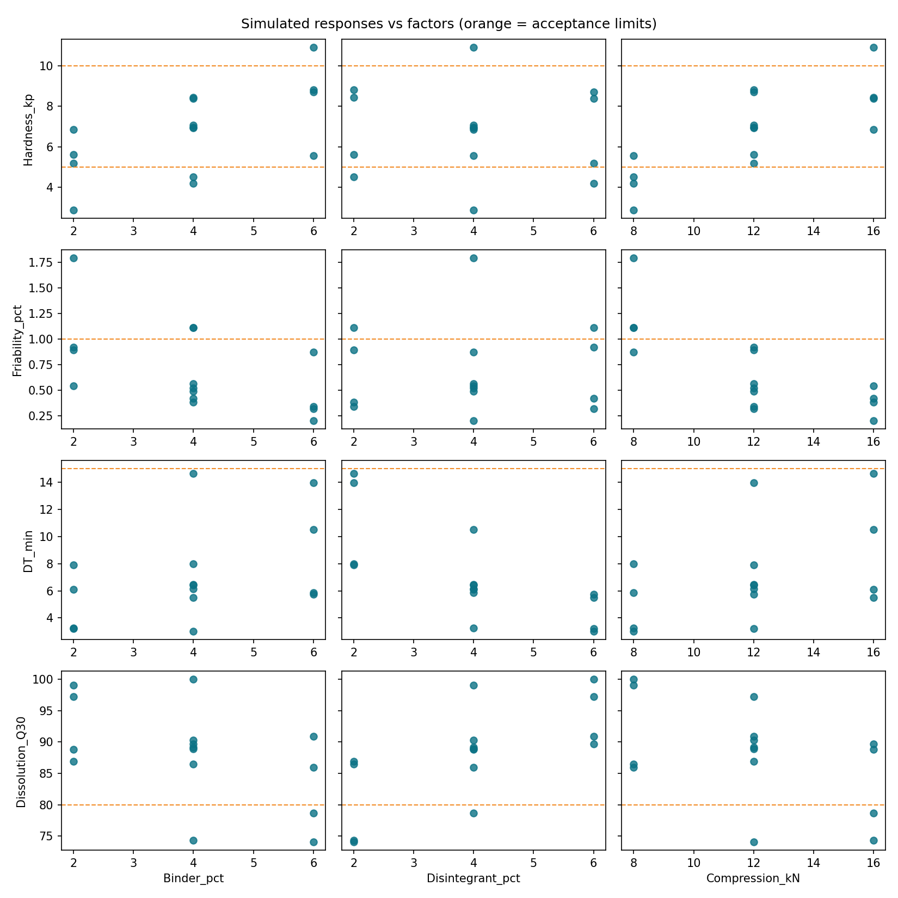
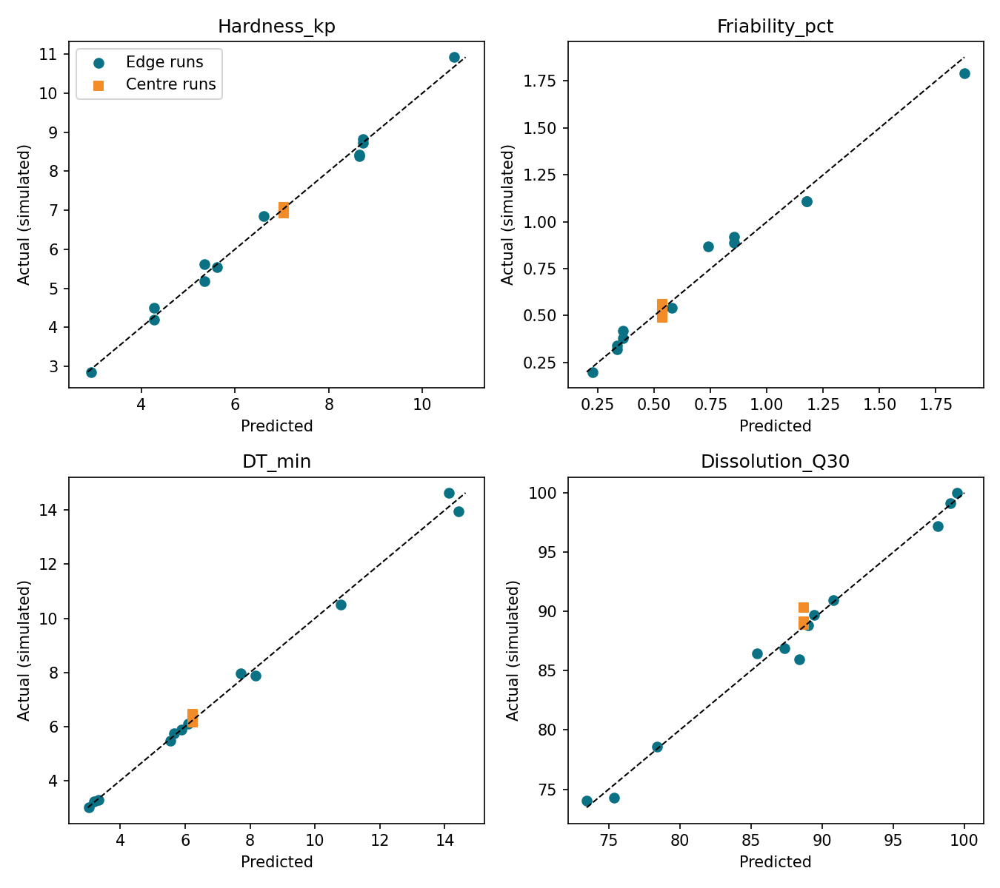

# QbD-Based Process Development of a Simulated Immediate-Release Tablet

**DoE, design space, confirmatory batches and scale-up plan**
Author: Harsh Paswan, B.Tech Chemical Engineering, BIT Mesra · October 2026

> **Data notice.** This is a methodology project. The process responses are **simulated** from documented
> cause-and-effect relationships (Appendix A), not measured in a laboratory. The model product is a
> hypothetical BCS Class II API. Equipment sizes, densities and demand are illustrative assumptions
> (Appendix B). Nothing here is a real formulation, and no claim is made about any marketed product.

## 1. Objective and scope

Develop and optimise a wet-granulation process for a hypothetical 100 mg immediate-release film-coated
tablet using Quality by Design (QbD) principles: define the target product profile and critical quality
attributes (CQAs), rank process risks, run a designed experiment, model the responses, define a design space,
confirm it with confirmatory batches (CB), and plan scale-up from a 1 kg lab batch to a commercial batch.

The workflow follows the structure of ICH Q8(R2) (pharmaceutical development) and ICH Q9 (quality risk management).

## 2. Quality target product profile (QTPP) and CQAs

| Attribute           | Target                               | CQA   | Acceptance criterion               |
|:--------------------|:-------------------------------------|:------|:-----------------------------------|
| Dosage form         | Immediate-release film-coated tablet | No    | nan                                |
| Strength            | 100 mg (model BCS Class II API)      | No    | nan                                |
| Assay               | 95.0-105.0% of label claim           | Yes   | 95.0-105.0%                        |
| Content uniformity  | Uniform dose per tablet              | Yes   | Acceptance Value <= 15 (USP <905>) |
| Dissolution         | Rapid release                        | Yes   | Q30 >= 80% (assumed)               |
| Hardness            | Robust for handling and coating      | Yes   | 5-10 kp (assumed)                  |
| Friability          | Low mass loss                        | Yes   | <= 1.0% (USP <1216>)               |
| Disintegration time | Fast breakup                         | Yes   | <= 15 min (assumed)                |
| Weight variation    | Consistent tablet weight             | Yes   | Per pharmacopoeial limits          |

Acceptance criteria marked "assumed" in the code (Q30, hardness range, disintegration time) are working
values for this exercise and should be replaced with product-specific limits.

## 3. Initial risk assessment (FMEA)

Ten process parameters were scored for severity (S), occurrence (O) and detectability (D) on a 1–10 scale
(RPN = S × O × D). The six highest-ranked parameters:

| Parameter                               | Unit operation   |   S |   O |   D |   RPN |
|:----------------------------------------|:-----------------|----:|----:|----:|------:|
| Binder concentration (% w/w)            | Wet granulation  |   7 |   7 |   5 |   245 |
| Compression force (kN)                  | Compression      |   8 |   7 |   4 |   224 |
| Granulation endpoint (water / wet mass) | Wet granulation  |   7 |   5 |   6 |   210 |
| Disintegrant level (% w/w)              | Blending         |   8 |   6 |   4 |   192 |
| Lubricant blending time                 | Lubrication      |   6 |   5 |   5 |   150 |
| Blend uniformity / blending time        | Blending         |   9 |   3 |   5 |   135 |

Binder level, compression force and disintegrant level were selected as the DoE factors. The granulation endpoint
ranked third but was held under control (wet-mass consistency / power consumption) rather than varied, and is
therefore **not** characterised by this study. Scores are my own judgement and are not data.

## 4. Design of experiments

A three-factor, 15-run Box-Behnken design (12 edge runs + 3 centre points, randomised run order):

| Factor | Low | Centre | High |
|---|---|---|---|
| Binder (% w/w) | 2.0 | 4.0 | 6.0 |
| Disintegrant (% w/w) | 2.0 | 4.0 | 6.0 |
| Compression force (kN) | 8.0 | 12.0 | 16.0 |

Fixed: lubricant 1.0% w/w for 3 min, tablet weight 250 mg (100 mg API), 1 kg batch, API particle size, granulation
endpoint by wet-mass consistency. The three centre points provide pure-error and curvature information.

Simulated results (all runs):

|   Run |   Binder % |   Disint. % |   Force kN |   Hardness kp |   Friab. % |   DT min |   Q30 % | All CQAs pass   |
|------:|-----------:|------------:|-----------:|--------------:|-----------:|---------:|--------:|:----------------|
|     1 |          2 |           4 |          8 |          2.86 |       1.79 |     3.27 |   99.1  | False           |
|     2 |          4 |           4 |         12 |          7.07 |       0.52 |     6.42 |   90.33 | True            |
|     3 |          4 |           2 |         16 |          8.43 |       0.38 |    14.64 |   74.29 | False           |
|     4 |          6 |           6 |         12 |          8.72 |       0.32 |     5.75 |   90.94 | True            |
|     5 |          4 |           6 |          8 |          4.19 |       1.11 |     3    |  100    | False           |
|     6 |          4 |           2 |          8 |          4.51 |       1.11 |     7.97 |   86.45 | False           |
|     7 |          2 |           2 |         12 |          5.61 |       0.89 |     7.89 |   86.9  | True            |
|     8 |          2 |           6 |         12 |          5.19 |       0.92 |     3.22 |   97.22 | True            |
|     9 |          4 |           4 |         12 |          6.92 |       0.56 |     6.15 |   89.14 | True            |
|    10 |          6 |           2 |         12 |          8.83 |       0.34 |    13.95 |   74.02 | False           |
|    11 |          6 |           4 |         16 |         10.92 |       0.2  |    10.51 |   78.62 | False           |
|    12 |          2 |           4 |         16 |          6.85 |       0.54 |     6.11 |   88.8  | True            |
|    13 |          4 |           6 |         16 |          8.38 |       0.42 |     5.48 |   89.7  | True            |
|    14 |          4 |           4 |         12 |          6.97 |       0.49 |     6.45 |   88.92 | True            |
|    15 |          6 |           4 |          8 |          5.55 |       0.87 |     5.88 |   85.95 | True            |

9 of 15 runs met every acceptance criterion.

## 5. Response-surface models

Full quadratic models in coded units (−1 to +1) were reduced by backward elimination (p > 0.10 removed, hierarchy
kept). Friability and disintegration time were modelled on the natural-log scale.

| Response        | Modelled on   | Retained terms                                   |    R² |   Adj. R² |   Pred. R² |   Adeq. precision |   Lack-of-fit p |
|:----------------|:--------------|:-------------------------------------------------|------:|----------:|-----------:|------------------:|----------------:|
| Hardness_kp     | original      | Binder, Force, Binder×Force, Force²              | 0.993 |     0.99  |      0.977 |            64.901 |           0.105 |
| Friability_pct  | ln            | Binder, Force, Force²                            | 0.979 |     0.973 |      0.955 |            42.548 |           0.34  |
| DT_min          | ln            | Binder, Disint., Force, Disint.², Force²         | 0.997 |     0.996 |      0.993 |            80.966 |           0.467 |
| Dissolution_Q30 | original      | Binder, Disint., Force, Binder×Disint., Disint.² | 0.985 |     0.976 |      0.956 |            34.213 |           0.277 |

All four models have predicted R² within 0.2 of adjusted R², adequate precision well above 4, and a
non-significant lack of fit (p > 0.05; note that with only 2 pure-error degrees of freedom the test has low power).

**Coefficients of the reduced models** (coded units; ln scale for friability and disintegration time):

| Response        | Term (coded)   |   Coefficient | 95% CI           |   p-value |
|:----------------|:---------------|--------------:|:-----------------|----------:|
| Hardness_kp     | Binder         |         1.689 | 1.526 to 1.852   |    0      |
| Hardness_kp     | Force          |         2.184 | 2.021 to 2.347   |    0      |
| Hardness_kp     | Binder×Force   |         0.345 | 0.115 to 0.575   |    0.0075 |
| Hardness_kp     | Force²         |        -0.583 | -0.821 to -0.345 |    0.0003 |
| Friability_pct  | Binder         |        -0.467 | -0.541 to -0.392 |    0      |
| Friability_pct  | Force          |        -0.589 | -0.664 to -0.514 |    0      |
| Friability_pct  | Force²         |         0.197 | 0.088 to 0.307   |    0.0022 |
| DT_min          | Binder         |         0.285 | 0.260 to 0.309   |    0      |
| DT_min          | Disint.        |        -0.468 | -0.492 to -0.443 |    0      |
| DT_min          | Force          |         0.302 | 0.278 to 0.326   |    0      |
| DT_min          | Disint.²       |         0.086 | 0.050 to 0.122   |    0.0004 |
| DT_min          | Force²         |        -0.039 | -0.075 to -0.003 |    0.0356 |
| Dissolution_Q30 | Binder         |        -5.311 | -6.273 to -4.349 |    0      |
| Dissolution_Q30 | Disint.        |         7.025 | 6.063 to 7.987   |    0      |
| Dissolution_Q30 | Force          |        -5.011 | -5.973 to -4.049 |    0      |
| Dissolution_Q30 | Binder×Disint. |         1.65  | 0.290 to 3.010   |    0.0227 |
| Dissolution_Q30 | Disint.²       |        -1.254 | -2.662 to 0.154  |    0.0747 |

Main findings: hardness is driven mainly by compression force and binder level (with a positive binder × force
interaction and diminishing returns at high force); friability falls as hardness rises; disintegration time
lengthens with binder and force and shortens with disintegrant; dissolution Q30 falls with binder and force and
rises with disintegrant.

**Validation against the simulator.** Because the data are simulated, the true effects are known. The full 15-run
analysis recovered 16 of 18 true non-zero effects inside their 95% confidence intervals
(36 of 40 coefficients including true zeros). It produced 1 false positive at p < 0.05
(AB for Dissolution_Q30 (p = 0.035)), and the reduced
disintegration-time model retained one term (force²) whose true effect is zero. This is the kind of
model-selection noise expected from a 15-run design, and it is why confirmation runs are needed.

## 6. Optimisation and design space

**Desirability.** Each response was converted to a 0–1 score (hardness: target 7.5 kp within 5–10; friability: 1 at
≤ 0.3%, 0 at ≥ 1.0%; disintegration time: 1 at ≤ 5 min, 0 at ≥ 15 min; Q30: 0 at ≤ 80%, 1 at ≥ 95%) and combined
as a geometric mean.

**Design space.** For each point of a 21 × 21 × 21 grid, 1,000 Monte Carlo runs combined (i) model-coefficient
uncertainty, (ii) residual noise and (iii) process variability (assumed SD: binder ±0.15%, disintegrant ±0.15%,
force ±0.4 kN). The design space is the region where P(all four CQAs pass) ≥ 90%; it covers
56.2% of the explored cube.

| Point | Binder % | Disint. % | Force kN | Desirability | P(all CQAs), 10,000 runs |
|---|---|---|---|---|---|
| Unconstrained optimum | 4.8 | 6.0 | 11.6 | 0.906 | 100.0% |
| **Proposed operating point** (disintegrant ≤ 5%) | 3.8 | 5.0 | 13.2 | 0.846 | 100.0% |

The unconstrained optimum sits on the edge of the studied range (6% disintegrant), above the roughly 5% w/w that is
typical for superdisintegrants (to be verified against an excipient handbook). A practical limit of 5% was therefore
applied, giving the proposed operating point. Predicted responses there (mean and 5th–95th percentile):

| Response        |   Mean |   5th pct |   95th pct |
|:----------------|-------:|----------:|-----------:|
| Hardness_kp     |   7.47 |      6.95 |       7.98 |
| Friability_pct  |   0.48 |      0.4  |       0.58 |
| DT_min          |   5.36 |      4.89 |       5.87 |
| Dissolution_Q30 |  90.81 |     88.37 |      93.27 |

**Proposed normal operating range (NOR)**, the largest box around the operating point lying fully inside the design space
and the practical limit: Binder (% w/w): 2.8 to 4.8; Disintegrant (% w/w): 4.0 to 5.0; Compression force (kN): 11.2 to 15.2.

"100%" means no failures in 10,000 simulated runs under the model's assumptions. It is not a real-world guarantee.

## 7. Confirmatory batches

Acceptance rule (written before running): accept if all 12 results (3 batches × 4 CQAs) meet specification; also report
how many fall inside the model's 95% prediction interval (computed at each batch's achieved factor values). A result
outside the interval is documented and monitored, not an automatic rejection (about 5% fall outside by chance).

| Batch   |   Binder % |   Disint. % |   Force kN |
|:--------|-----------:|------------:|-----------:|
| CB1     |       3.81 |        4.93 |      13.22 |
| CB2     |       3.71 |        4.84 |      13.57 |
| CB3     |       3.85 |        5.14 |      12.85 |

| Batch   | Response        |   Observed |   Predicted | 95% PI         | Inside PI   | Meets spec   |
|:--------|:----------------|-----------:|------------:|:---------------|:------------|:-------------|
| CB1     | Hardness_kp     |       7.53 |        7.49 | 7.00 to 7.98   | True        | True         |
| CB1     | Friability_pct  |       0.39 |        0.48 | 0.38 to 0.60   | True        | True         |
| CB1     | DT_min          |       5.79 |        5.44 | 5.04 to 5.86   | True        | True         |
| CB1     | Dissolution_Q30 |      87.95 |       90.59 | 87.69 to 93.48 | True        | True         |
| CB2     | Hardness_kp     |       7.61 |        7.55 | 7.06 to 8.04   | True        | True         |
| CB2     | Friability_pct  |       0.52 |        0.47 | 0.38 to 0.59   | True        | True         |
| CB2     | DT_min          |       5.73 |        5.59 | 5.18 to 6.02   | True        | True         |
| CB2     | Dissolution_Q30 |      89.25 |       90.13 | 87.22 to 93.04 | True        | True         |
| CB3     | Hardness_kp     |       7.13 |        7.35 | 6.86 to 7.84   | True        | True         |
| CB3     | Friability_pct  |       0.55 |        0.49 | 0.40 to 0.62   | True        | True         |
| CB3     | DT_min          |       4.9  |        5.12 | 4.75 to 5.52   | True        | True         |
| CB3     | Dissolution_Q30 |      92.02 |       91.56 | 88.67 to 94.44 | True        | True         |

**Result:** 12 of 12 results met specification and 12 of 12 fell inside the
95% prediction interval. Mean absolute prediction error: DT_min 4.4%, Dissolution_Q30 1.5%, Friability_pct 13.0%, Hardness_kp 1.4%.
**Decision: accept the operating point.**

*Limitation:* the confirmation "lab" is the same simulator that generated the DoE data, with new noise, so this check
validates the analysis pipeline rather than a real formulation.

## 8. Scale-up plan

**Batch size.** The largest core batch each commercial-scale unit can take (using its allowed fill range) is:
RMG 600 L: 151.5 kg · fluid-bed dryer 300 kg wet load: 209.8 kg · bin blender 600 L: 198.0 kg · coating pan 150 kg:
**135.0 kg (limiting, 90% maximum load)**. The commercial batch is therefore **135 kg**
(540,000 tablets). At an assumed demand of 60 million tablets/year this is 112 batches/year and about
1,867 press hours/year. The **exhibit batch** is the larger of 10% of the commercial batch or 100,000 units,
i.e. **25 kg** (this rule of thumb should be checked against the guidance for the target market).

**Raw material requirement** (API adjusted for assay and water content: 101.01 mg API per 100 mg label claim):

| Material                                         |   mg / tablet |   % w/w |   Lab (1 kg) |   Exhibit (25 kg) |   Commercial (135 kg) |
|:-------------------------------------------------|--------------:|--------:|-------------:|------------------:|----------------------:|
| API (potency-adjusted)                           |       101.008 |    40.4 |        0.404 |            10.101 |                54.544 |
| Binder (e.g., povidone)                          |         9.5   |     3.8 |        0.038 |             0.95  |                 5.13  |
| Superdisintegrant (e.g., croscarmellose sodium)  |        12.5   |     5   |        0.05  |             1.25  |                 6.75  |
| Lubricant (e.g., magnesium stearate)             |         2.5   |     1   |        0.01  |             0.25  |                 1.35  |
| Diluent (e.g., microcrystalline cellulose), q.s. |       124.492 |    49.8 |        0.498 |            12.449 |                67.226 |
| Purified water (granulation; removed in drying)  |               |         |        0.297 |             7.425 |                40.095 |
| Film-coat solids (3.0% gain, incl. 10% overage)  |               |         |        0.033 |             0.825 |                 4.455 |
| Purified water (coating dispersion)              |               |         |        0.187 |             4.675 |                25.245 |

**Equipment train and change parts:**

| Scale      | Unit operation              | Equipment (assumed generic size)   | Fill   |
|:-----------|:----------------------------|:-----------------------------------|:-------|
| Lab        | RMG (high-shear granulator) | 5 L bowl                           | 40%    |
| Lab        | Fluid-bed dryer             | 2 kg wet load                      | 64%    |
| Lab        | Bin blender                 | 5 L bin                            | 36%    |
| Lab        | Coating pan                 | 2 kg cores                         | 50%    |
| Lab        | Rotary tablet press         | 8 stations, PCD 150 mm, 20 rpm     |        |
| Exhibit    | RMG (high-shear granulator) | 150 L bowl                         | 33%    |
| Exhibit    | Fluid-bed dryer             | 60 kg wet load                     | 54%    |
| Exhibit    | Bin blender                 | 100 L bin                          | 45%    |
| Exhibit    | Coating pan                 | 30 kg cores                        | 83%    |
| Exhibit    | Rotary tablet press         | 27 stations, PCD 250 mm, 15 rpm    |        |
| Commercial | RMG (high-shear granulator) | 600 L bowl                         | 45%    |
| Commercial | Fluid-bed dryer             | 300 kg wet load                    | 58%    |
| Commercial | Bin blender                 | 600 L bin                          | 41%    |
| Commercial | Coating pan                 | 150 kg cores                       | 90%    |
| Commercial | Rotary tablet press         | 45 stations, PCD 400 mm, 12 rpm    |        |

**Scale-up parameters** (starting points to be confirmed in the exhibit batches):

| Parameter               |    Lab |   Exhibit |   Commercial |
|:------------------------|-------:|----------:|-------------:|
| RMG_impeller_D_m        |   0.15 |     0.466 |         0.74 |
| RMG_rpm_const_tip_speed | 500    |   161     |       101    |
| RMG_rpm_const_Froude    | 500    |   284     |       225    |
| Granulating_fluid_pct   |  30    |    30     |        30    |
| Blender_rpm             |  25    |    15     |        10    |
| Lubrication_revolutions |  75    |    75     |        75    |
| Lubrication_minutes     |   3    |     5     |         7.5  |
| Press_rpm               |  20    |    15     |        12    |
| Press_dwell_vs_lab      |   1    |     0.8   |         0.62 |
| Compression_force_kN    |  13.2  |    13.2   |        13.2  |
| Coat_weight_gain_pct    |   3    |     3     |         3    |

Impeller speed follows geometric similarity with either constant tip speed or constant Froude number; the two rules give
very different speeds (see table), so the exhibit batches, with the granulation endpoint controlled by power consumption
or wet-mass consistency, must decide. Lubrication is held at constant revolutions (75), because lubricant blending time
was ranked as a risk and affects dissolution and hardness. Press speed is set from a dwell-time ratio against the lab
press.

## 9. Control strategy (draft)

| Item                                           | Type        | Proposed control                                                         | Protects CQA                           | Basis / status                                                      |
|:-----------------------------------------------|:------------|:-------------------------------------------------------------------------|:---------------------------------------|:--------------------------------------------------------------------|
| Binder level                                   | CPP         | Target 3.8% w/w; range 2.8-4.8                                           | Hardness, friability, DT, dissolution  | DoE models + design space (Steps 4-5)                               |
| Disintegrant level                             | CPP         | Target 5.0% w/w; range 4.0-5.0                                           | DT, dissolution                        | DoE models + design space; target sits at the practical upper limit |
| Compression force                              | CPP         | Target 13.2 kN; range 11.2-15.2; automatic reject outside                | Hardness, friability, DT, dissolution  | DoE models + design space                                           |
| Granulation endpoint                           | IPC         | Impeller power consumption / wet-mass consistency window                 | Dissolution, content uniformity        | Fixed in the DoE, NOT studied: set the window from exhibit batches  |
| Drying endpoint                                | IPC         | LOD limit at end of drying                                               | Assay, hardness, stability             | Not studied: set the limit from exhibit data                        |
| Lubrication                                    | CPP (fixed) | 75 revolutions (time = revolutions / rpm)                                | Dissolution, hardness                  | FMEA ranked this risk; held constant in the DoE                     |
| API particle size                              | CMA         | d90 limit on incoming API                                                | Dissolution, content uniformity        | Fixed in the DoE: set the limit from supplier data and studies      |
| Blend uniformity                               | IPC         | Blend sampling plan and acceptance limits before compression             | Content uniformity, assay              | Highest-severity FMEA item                                          |
| Tablet weight, hardness, thickness, friability | IPC         | Periodic checks during compression                                       | Weight variation, hardness, friability | Specification limits from Step 1                                    |
| Finished-product CQAs                          | Release     | Assay 95-105%; CU AV <= 15; Q30 >= 80%; DT <= 15 min; friability <= 1.0% | All CQAs                               | Step 1 acceptance criteria (assumed values)                         |

The disintegrant target sits at the upper practical limit, so normal weighing variability could exceed 5%.
Consider moving the target slightly lower (for example to 4.8%) before the exhibit batches.

## 10. Limitations

- All process responses are simulated, using assumed relationships and coefficients (Appendix A).
- Confirmation uses the same simulator as the DoE (see Section 7).
- The model is valid only inside the studied ranges (binder 2–6%, disintegrant 2–6%, force 8–16 kN).
- Granulation endpoint, drying, milling, API particle size and lubrication were held fixed and are not characterised.
- A 15-run design leaves 5 residual degrees of freedom in the full model; effect estimates are uncertain (Section 5).
- Equipment sizes, bulk densities, coating parameters and demand are generic assumptions (Appendix B). Scale effects
  are not modelled; the scale-up parameters are starting points only.
- No stability, analytical-method, bioequivalence or regulatory-filing work is included.

## 11. References

- ICH Q8(R2) Pharmaceutical Development; ICH Q9 Quality Risk Management; ICH Q10 Pharmaceutical Quality System.
- USP general chapters <905> Uniformity of Dosage Units and <1216> Tablet Friability.

*(Please verify these references and the acceptance criteria against the current official documents before relying on them.)*

## Appendix A. Simulator relationships (coded factors A = binder, B = disintegrant, C = compression force)

| Response | Assumed model | Noise |
|---|---|---|
| Hardness (kp) | 7.0 + 1.6A − 0.3B + 2.2C + 0.4AC − 0.5C² | SD 0.30 |
| Friability (%) | 0.55 · exp(−0.30 · (hardness − 7)) | 10% log-normal |
| Disintegration time (min) | exp(ln 6 + 0.25A − 0.45B + 0.30C + 0.10B²) | 5% log-normal |
| Dissolution Q30 (%) | 88 − 14 · ln(DT / 6) − 1.5A, capped at 100 | SD 1.5 |

## Appendix B. Key assumptions

API assay 99.5% (dried basis), water 0.5%; lubricant 1.0% w/w; granulating water 30% w/w of intragranular mass;
film-coat gain 3.0% (15% solids dispersion, 10% preparation overage); bulk densities 0.50 (dry mix) and 0.55 kg/L (blend);
fill ranges RMG 30–50%, fluid-bed dryer 25–90%, blender 30–60%, coating pan 40–90%; demand 60 million tablets/year;
process SDs as in Section 6.
